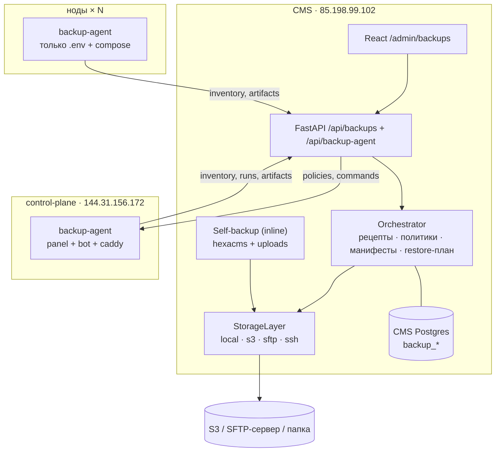

# Система бэкапа и аварийного восстановления (Backup & DR)

> Статус: **MVP реализован (backend + агент + UI), ревизия 3 решений зафиксирована**
> Дата: 2026-11-21 · реализация: 2026-11-25
> Проверено: миграция применяется дважды на PG16 (13 таблиц, 12 индексов), backend-тесты 363/363,
> `tsc --noEmit` без ошибок, `vite build` успешен, образ агента собран и проходит offline-smoke.
> End-to-end: inline-бэкап CMS создаёт 2 артефакта (БД + манифест), sha256/dowload/verify OK,
> артефакт переживает рестарт API (volume `backup_data`); агент регистрируется, шлёт inventory (7 контейнеров),
> забирает команду `scan` и подтверждает выполнение.
> Область: CMS NewWeb (FastAPI + React SPA) + агент на хостах (Remnawave Panel 3.4.3, Bedolaga Bot 4.7.0, Cabinet, ноды, CMS)
> Связанные: `PROJECT.md`, `docs/ARCHITECTURE.md`, `docs/CODEBASE_INDEX.md`, `ADR-001`, `ADR-002`

## Что изменилось в ревизии 2

| Ответ владельца | Как учтено |
|---|---|
| Хранилищ — бесконечно, настраиваются в Интеграциях, полный путь до папки | §7: отдельная сущность `backup_storages` + карточка-интеграция «Бэкапы»; типы `local` / `s3` / `sftp` / `ssh`; у каждого — произвольный `path`/`prefix` |
| Несколько уровней: полный раз в сутки, только БД раз в час/минуты | §8: политика = контейнер, внутри **уровни (tiers)** со своим scope, расписанием, retention и хранилищами |
| Хранить можно в CMS | §7: `local` как полноценный тип, но с предупреждением «это не offsite» |
| У CMS должен быть свой бэкап | §9: хост `self` (`transport=inline`, без агента), обязательная выгрузка offsite |
| Ставить агента на сервер по адресу, агент делает работу и передаёт в CMS | §5: наш агент, push + локальный fallback-планировщик |
| Для каждой ноды отдельно, тем же агентом | §5.6, §8.4: роль хоста `node`, политика «только конфиг ноды» |
| Всё гибко настраивается | §8, §10, §11: все параметры — данные в БД, не константы в коде |

## Зафиксированные решения (ревизия 3)

| Вопрос | Решение |
|---|---|
| Хранилища | **все типы сразу** + `rclone` (даёт Google Drive / Yandex Disk / Dropbox / B2 / OneDrive и ещё ~70 провайдеров) + произвольные `advanced`-параметры у каждого хранилища |
| Агент | Docker |
| Установка агента | **оба способа**: команда `curl \| bash` и автоустановка по SSH — оба в MVP |
| `quiesce` (остановка сервиса) | **только вручную**, никогда по расписанию. Плановые уровни всегда `online` |
| Ключ шифрования в CMS | да (для auto-restore), с подтверждением при restore |
| Уведомления | тонкая настройка в CMS: каналы, события, пороги, тихие часы, повторы, переопределения по хосту |
| SLA по умолчанию | БД — не старше **1 часа**, полный — **раз в 24 ч** |
| Интервал агента | heartbeat 30 с, poll команд 15 с |
| Retention | режим `auto`: число копий → дни считаются сами (и наоборот). Дефолт 48 копий БД / 14 дней полного |
| Логи | тумблер в уровне, по умолчанию выключено, с обрезкой размера |
| Telegram | любые бот/чат/тема; можно переиспользовать существующий канал с другой темой |
| Удаление хоста | артефакты остаются как `orphaned` |
| Подтверждение restore | только чекбокс + кнопка в UI |
| Навигация | новый раздел «Инфраструктура»: Бэкапы · Ноды · Панель (подробно §13.1) |

---

## 1. Цель

Один раздел админки, который:

1. **Подключает серверы** по адресу и ставит на них агента (в т.ч. на каждую ноду).
2. **Сам находит**, что установлено (рецепты + инвентарь от агента).
3. **Бэкапит по уровням**: БД часто и дёшево, полный срез редко и надёжно.
4. **Складывает в любое число хранилищ** (CMS, S3, SFTP-сервер, вплоть до папки).
5. **Восстанавливает** как поверх текущего сервера, так и на новый (агент на новом хосте выполняет план).
6. **Следит за собой**: CMS бэкапит собственную БД/uploads и умеет восстановиться.

---

## 2. Вердикт и что нужно

**Реализуемо полностью.** Ключевое решение: работа выполняется **агентом на хосте**, а CMS — мозг (рецепты, политики, манифесты, план восстановления, UI). Это снимает главную проблему прошлой ревизии: CMS больше не единая точка отказа для запуска бэкапов.

Что нужно добавить в проект:

| № | Что | Где | Зачем |
|---|-----|-----|-------|
| 1 | `asyncssh` (SFTP + exec) | `web/backend/requirements.txt` | bootstrap агента по SSH, тип хранилища `sftp` |
| 2 | `boto3` | `web/backend/requirements.txt` | S3-совместимые хранилища |
| 3 | `postgresql-client` в образ `api` | `web/backend/Dockerfile` | бэкап собственной БД CMS |
| 4 | volume `uploads_data:ro` в сервис `api` | `docker-compose.prod.yml` | файловый бэкап CMS |
| 5 | Новый каталог `backup-agent/` | корень репо | исходники агента, версионируемый протокол |
| 6 | Таблица `backup_storages` | миграция | бесконечный список хранилищ (не влезает в static `SettingDef`) |
| 7 | Токены агентов | таблица `backup_hosts`/`backup_agents` | авторизация агента, HMAC команд |
| 8 | `rclone` в образе агента | `backup-agent/Dockerfile` | универсальный доступ к 70+ облакам одним типом хранилища |

Существующее переиспользуем: `core/crypto.py` (AES-256-CBC, PHP-совместимый) для секретов хранилищ и токенов; `core/settings_registry.py` — только для *статических* настроек; паттерн `asyncio`-цикла в `lifespan` (`web/backend/main.py:34-153`).

---

## 3. Почему не впихиваем хранилища в `settings`

Разбор текущего кода:

- `web/backend/api/v1/settings.py:210,237` — POST/PUT принимают только `ALLOWED_KEYS`; произвольный ключ нельзя.
- `web/backend/core/settings_registry.py:16-31` — `SettingDef` статичен, `BLOB_KEYS` (`:493`) даёт JSON-блоб без схемы.
- `settings.py:154-158` — шифруются **только** `is_secret` поля; пароли внутри JSON-блоба легли бы в БД открытым текстом.
- UI `Settings.tsx:261-360` умеет `bool/select/text/secret/number/textarea/json`, но **не умеет список объектов** — редактора массива нет.

Вывод: бесконечный список хранилищ с секретами и валидацией — это отдельная таблица + отдельный экран. А в «Интеграциях» появляется **карточка-указатель** на этот экран (как `bot_db` — интеграция со своим состоянием и тестом). Это и есть «по канону»: `settings` — конфиг, подсистема с сущностями — своя таблица.

---

## 4. Архитектура



### 4.1 Граница исполнения (решение)

| Вариант | Итог |
|---|---|
| A. Всё по SSH из FastAPI | оставляем **только** для bootstrap агента и аварийного «CMS недоступна, а бэкап нужен сейчас» |
| B. Агент с локальным cron, CMS только принимает | отвергнут как единственный: теряем управляемость и «мозг» |
| **C. Агент + CMS-оркестратор (выбран)** | агент исполняет и умеет работать автономно; CMS решает что/когда/куда и хранит манифесты |

Поток: CMS отдаёт агенту **desired state** (политики + рецепты + версия), агент исполняет по локальному расписанию, отчитывается и выгружает артефакты. Если CMS недоступна — агент продолжает по закэшированному состоянию, складывает артефакты в spool-каталог и досылает позже. Это закрывает пункт «агент делает, CMS решает».

---

### 4.2 Границы модуля (что именно добавляется)

В проекте **нет runtime-реестра модулей**: расширение = вертикальный срез по соглашению (как `support/` и `bedolaga/`) + ручная проводка в 4 точках. Бэкапы делаем так же, плюс отдельный внешний компонент — агент.

| Слой | Что добавляется | Тип |
|---|---|---|
| Backend | `web/backend/api/v1/backups/` (router-пакет), `web/backend/api/v1/backup_agent.py` | модуль CMS |
| Backend-core | `web/backend/core/backup/` (`recipes.py`, `orchestrator.py`, `storage/`, `manifest.py`, `notifications.py`, `crypto.py`) | модуль CMS |
| Схемы | `web/backend/schemas/backup.py` | модуль CMS |
| БД | `db/migrations/2026-11-21-backup-system.sql` + `ensure_backup_schema()` | модуль CMS |
| Frontend | `web/frontend/src/pages/backups/*`, `pages/infrastructure/Nodes.tsx`, `Panel.tsx`, `api/backups.ts` | модуль CMS |
| Агент | `backup-agent/` (Docker-образ, `PROTOCOL.md`) | **отдельный сервис**, версионируется независимо |
| Проводка | `main.py:256-308` (+2 роутера), `navigation.ts` (+1 группа), `App.tsx` (+3 роута), `core/integrations.py` (+1 `IntegrationDef`) | 4 статические точки |

Общие слои **не дублируются**: `core/crypto.py` (шифрование секретов), `api/deps.py` (`get_current_admin`), `core/database.py` (пул), `core/settings_registry.py` (только для статических настроек, см. §3).

Важно: это **не плагин**. `ADR-002:63` фиксирует, что `plugins/` есть в Remnawave и нет в CMS; динамической загрузки в админке нет. Модульность проекта — соглашение о раскладке для ручного копирования (`ADR-002:14,49-52`), а формальный механизм расширения существует только на PHP-стороне сайта (`index.php:42-47` — `glob(plugins/*.php)`, `core/Hooks.php:13-49`). Если позже понадобится настоящий реестр модулей — это отдельный рефакторинг, не часть бэкапов.

## 5. Агент `backup-agent`

### 5.1 Чем отличается от агента `remnawave-admin-main`

Изучен их агент (для нас — образец, не зависимость):

- `remnawave-admin-main/node-agent/install.sh:60-140` → `--uuid/--url/--token`, каталог `/opt/remnawave-node-agent`, docker compose, `.env` с `AGENT_*`.
- `node-agent/src/sender.py:21-23` → push телеметрии `POST /api/v2/collector/batch`, `Bearer`.
- `node-agent/src/ws_client.py:39-58` → WS-канал команд, ping 30 с, reconnect 1–30 с.
- `core/agent_hmac.py` + `command_runner.py:54-80` → HMAC-SHA256 команд, окно 60 с.
- `command_runner.py:139-175` → `exec_script` через `/bin/sh -c`, host-mode через `nsenter`.
- Автообновления нет (`install.sh:153` — ручной `docker compose pull`).
- Бэкап у их агента отсутствует — есть только серверный `/api/v2/backups` (`backup.py:72-316`).

**Наш агент:** Python 3.12-slim, docker compose, **HTTP polling вместо WS** (проще для firewall, не нужен постоянный канал), версионируемый протокол, автообновление по `desired_version`, spool-очередь, и главное — он умеет `pg_dump`/`tar`/шифрование/restore, а не только телеметрию.

### 5.2 Установка

```
POST /api/backups/hosts            → создать хост, получить host_id
POST /api/backups/hosts/{id}/agent-install
   → { token, install_command }
```

Команда:

```bash
curl -sSL https://hexaveil.xyz/api/backup-agent/install.sh | bash -s -- \
  --url https://hexaveil.xyz --host-id <uuid> --token <one-time-token>
```

`install.sh` (отдаётся бэкендом, не из репо напрямую):
1. Проверяет `docker`, `docker compose`, `curl`, место на диске.
2. Создаёт `/opt/hexaveil-backup-agent`, пишет `.env` (`AGENT_URL`, `AGENT_HOST_ID`, `AGENT_TOKEN`, `AGENT_SPOOL_DIR=/var/lib/hexaveil-agent`), `chmod 600`.
3. `docker compose pull && up -d`.
4. Агент вызывает `POST /api/backup-agent/v1/register` → CMS инвалидирует одноразовый токен, выдаёт постоянный.

Альтернатива «по кнопке»: если у хоста заданы SSH-креды, CMS сама заходит и выполняет те же шаги (`POST /hosts/{id}/agent-install?via=ssh`). Креды используются **однократно** для bootstrap и не нужны для дальнейшей работы.

### 5.3 Конфиг агента (`.env`)

```env
AGENT_URL=https://hexaveil.xyz
AGENT_HOST_ID=<uuid>
AGENT_TOKEN=<constant>
AGENT_SPOOL_DIR=/var/lib/hexaveil-agent
AGENT_CONCURRENCY=1
AGENT_TZ=Europe/Moscow
AGENT_HOST_MODE=false        # true → nsenter для команд на хосте
AGENT_LOG_LEVEL=info
```

### 5.4 Монтирования

| Что | Зачем |
|---|---|
| `/var/run/docker.sock` | `docker exec` для `pg_dump`, `docker run` для tar-volume |
| `/opt/remnawave:ro` | конфиги/сертификаты панели |
| `/opt/remnanode:ro` | конфиг ноды |
| `/srv/cabinet:ro` | статика кабинета |
| `/var/lib/hexaveil-agent` (rw) | spool + временные дампы |

`privileged` не нужен — достаточно docker.sock и ro-монтирований. Это заметно безопаснее их агента.

### 5.5 Протокол (версионируемый, `backup-agent/PROTOCOL.md`)

| Метод | Путь | Назначение |
|---|---|---|
| POST | `/api/backup-agent/v1/register` | первичная регистрация, отдаёт `agent_id` |
| POST | `/api/backup-agent/v1/heartbeat` | каждые 30 с: версия, uptime, spool_bytes, disk_free |
| GET | `/api/backup-agent/v1/state?if_none_match=` | desired state: политики, рецепты, `desired_version` |
| POST | `/api/backup-agent/v1/inventory` | результат сканирования (`docker ps/inspect`, версии, digest) |
| POST | `/api/backup-agent/v1/runs` | создать run (agent-initiated по локальному расписанию) |
| PATCH | `/api/backup-agent/v1/runs/{id}` | шаги, прогресс, лог |
| POST | `/api/backup-agent/v1/runs/{id}/artifacts` | зарегистрировать артефакт (sha256, размер) + получить upload-URL |
| PUT | `/api/backup-agent/v1/upload/{token}` | потоковая загрузка артефакта |
| GET | `/api/backup-agent/v1/commands` | очередь команд: `scan`, `backup_now`, `restore`, `cancel`, `update` |

Авторизация: `Authorization: Bearer <AGENT_TOKEN>` + `X-Agent-Version`. Для команд restore — дополнительно HMAC-SHA256 по телу с ключом `sha256(CMS_SECRET:agent_token)` и окном 300 с (как у них, но длиннее окно: restore дольше).

Загрузка артефактов: агент шифрует локально и **льёт в CMS**, CMS перекладывает в целевое хранилище. Прямая выгрузка в S3 по presigned URL — оптимизация v2 (не отдаём долгоживущие креды на ноды).

### 5.6 Ноды

Агент на ноде поднимается тем же `install.sh` с `--role node`. Единственный артефакт — `.env` + `docker-compose.yml` (там `SECRET_KEY`, `NODE_PORT`). Политика «конфиг ноды» — раз в сутки + при изменении файла (агент считает sha256 и создаёт внеплановый run, если конфиг поменялся). Полный дамп ноды не нужен: она state-less, данные в панели.

### 5.7 Автономность и spool

- Агент кэширует `state` в `/var/lib/hexaveil-agent/state.json` (атомарная запись через `tmp`+`rename`).
- Если CMS недоступна: выполняет расписание по кэшу, пишет артефакты в `spool/`, помечает `pending_upload`.
- При восстановлении связи: `POST /runs` (с исходным `client_run_id` для идемпотентности) → загрузка → очистка spool.
- Лимит spool (по умолчанию 10 ГБ): при переполнении — удаляет самые старые **незагруженные** и пишет алерт в CMS, когда связь вернётся.

### 5.8 Обновление агента

CMS отдаёт `desired_version` в `state`. Агент сравнивает, при отличии:
1. `docker pull ghcr.io/hexaveil/backup-agent:<version>` через docker.sock,
2. `docker compose up -d`,
3. при неудаче — откат на предыдущий тег и статус `update_failed` в heartbeat.

Версия агента видна в UI; есть кнопка «Обновить все агенты».

---

## 6. Рецепты (умность)

YAML в `web/backend/core/backup/recipes/*.yaml`, читаются при старте CMS и **передаются агенту** в `state` (агент не хранит собственные копии — единый источник правды).

```yaml
id: remnawave-panel
title: Remnawave Panel
version: 1
detect:
  any:
    - docker_image: "^remnawave/backend:"
    - docker_container: "^remnawave$"
  min_confidence: high
artifacts:
  database:
    kind: postgres
    container: remnawave-db
    env_from_container: [POSTGRES_USER, POSTGRES_DB]
    password_from: /opt/remnawave/.env:POSTGRES_PASSWORD
    method: pg_dump
    format: custom
    consistency: online
  files:
    - path: /opt/remnawave
      exclude: ["*.log", "*.tar.gz", "node_modules"]
      required: [".env", "docker-compose.yml"]
    - path: /opt/remnawave/nginx
      secret: true
  logs:
    enabled: false          # по умолчанию выключено; включается тумблером в UI
    paths: ["/opt/remnawave/logs", "/var/lib/docker/containers/*/*-json.log"]
    max_size_mb: 500        # обрезка, чтобы логи не съели бэкап
  redis:
    container: remnawave-redis
    method: none
    reason: "valkey --save '' --appendonly no"
manifest:
  capture: [docker_image_digest, app_version, migrations_table:_prisma_migrations]
secret_env_keys: [APP_SECRET, POSTGRES_PASSWORD, WEBHOOK_SECRET_HEADER]
healthcheck:
  command: "curl -fsS http://127.0.0.1:3000/api/system/health"
  timeout: 60
restore:
  order: 10
  stop: [remnawave]
  steps: [restore_database, restore_files, start:remnawave, wait_healthy]
  destructive: true
  requires_versions_match: true
```

Набор: `remnawave-panel`, `remnawave-node`, `bedolaga-bot`, `bedolaga-cabinet`, `caddy`/`nginx`, `hexaveil-cms`. Новый сервис = новый YAML, без правки кода.

Discovery: агент делает `docker ps --format json`, `docker inspect` (только **имена** env-ключей), `docker compose ls`, `ss -ltn`, `df -h`; CMS матчит рецептами и возвращает `components` с `confidence`. `low` не включается автоматически — подтверждение в UI.

---

## 7. Хранилища как интеграция

### 7.1 Типы

| kind | Поля конфига (всё настраивается) | Комментарий |
|---|---|---|
| `local` | `path` | папка в CMS (`/var/lib/hexaveil/backups`). Удобно, но **не offsite** |
| `s3` | `endpoint`, `region`, `bucket`, `prefix` (полный путь-папка), `access_key`, `secret_key`, `path_style` | Beget / R2 / Selectel / MinIO / Backblaze B2 |
| `sftp` | `host`, `port`, `user`, `auth` (`password`\|`key`), `password`/`private_key`, `path` (абсолютный) | «другой сервер вплоть до папки» |
| `ssh` | `host`, `port`, `user`, `private_key`, `path` | то же через `rsync`/`scp` |
| `webdav` | `url`, `user`, `password`, `path` | Nextcloud, ownCloud и др. |
| `ftp` | `host`, `port`, `user`, `password`, `path`, `tls` | старые хостинги/хранилища |
| `rclone` | `remote` (имя remote), `path`, `provider_hint` | Google Drive, Yandex Disk, Dropbox, OneDrive, B2, Mega… — один тип на все |

У каждого хранилища: `name`, `enabled`, `is_default`, `last_check_at/ok`, `quota_bytes` (мягкий лимит) и блок
**`advanced`** — свободный набор параметров прямо из UI:

| advanced | Смысл | Дефолт |
|---|---|---|
| `timeout_sec` | таймаут операции | 600 |
| `concurrency` | параллельных загрузок | 2 |
| `chunk_size_mb` | размер части при multipart | 64 |
| `retries` / `retry_backoff_sec` | повторы и пауза | 3 / 30 |
| `path_template` | шаблон пути (`{host}/{yyyy}/{mm}/{dd}/{run}`) | см. §7.4 |
| `compression` | `none` / `gzip` / `zstd` | `zstd` |
| `encrypt` | шифровать артефакты | `true` |
| `checksum` | `sha256` (обязательно для verify) | `sha256` |
| `keep_versions` | версионирование объектов (если поддерживает) | `false` |
| `bandwidth_limit` | ограничение скорости (`rclone --bwlimit`-стиль) | `off` |
| `storage_class` | холодный класс (S3) | `standard` |

Любой параметр можно оставить «по умолчанию» — тогда берётся значение из глобальных настроек (§8.2).

### 7.2 Модель

```sql
CREATE TABLE IF NOT EXISTS backup_storages (
  id           uuid PRIMARY KEY DEFAULT gen_random_uuid(),
  name         text NOT NULL UNIQUE,
  kind         text NOT NULL CHECK (kind IN ('local','s3','sftp','ssh','webdav','ftp','rclone')),
  config       jsonb NOT NULL DEFAULT '{}',  -- не-секретные поля
  advanced     jsonb NOT NULL DEFAULT '{}',  -- таймауты, чанки, шаблон пути, сжатие…
  secrets      text,                          -- AES-256-CBC через core/crypto.py
  enabled      boolean NOT NULL DEFAULT true,
  is_default   boolean NOT NULL DEFAULT false,
  quota_bytes  bigint,
  used_bytes   bigint NOT NULL DEFAULT 0,
  last_check_at timestamptz,
  last_check_ok boolean,
  created_at   timestamptz NOT NULL DEFAULT now()
);
```

`secrets` — отдельная колонка, шифруется целиком (`core/crypto.py:28 encrypt`), в API никогда не отдаётся, только `mask()`-подобное отображение. Это закрывает дыру из §3, где JSON-блоб не шифровался.

### 7.3 Где в UI

Два входа к одной сущности:

1. **Настройки → Интеграции** → новая категория `Бэкапы` (`web/backend/core/integrations.py:72-107` `INTEGRATIONS`): карточка «Хранилища бэкапов» с состоянием (`N подключено, M с ошибкой`) и кнопками «Управлять» → `/backups?tab=storages`, «Проверить все» → `POST /api/backups/storages/test-all`.
2. **`/backups` → таб «Хранилища»**: полный CRUD, per-record «Проверить», график занятого места.

Тест хранилища: `local` — запись/чтение/удаление пробного файла; `s3` — `put_object`+`head_object`+`delete`; `sftp` — `connect`+`mkdir -p path`+`stat`+тестовая запись.

### 7.4 Layout

```
<storage_root>/
  hosts/<host-slug>/
    <YYYY>/<MM>/<DD>/bkp_<UTC>_<run8>/
      manifest.json
      manifest.json.hmac
      <artifact>.<ext>.age
```

`storage_root` = `path` для local/sftp/ssh, `s3://bucket/prefix` для s3. Объекты иммутабельны; `manifest.json` пишется последним = маркер завершённости; retention удаляет только целые `bkp_*` папки.

При удалении хоста его артефакты **не удаляются**: помечаются `orphaned`, остаются в хранилищах и доступны для восстановления вручную (защита от «удалил сервер — потерял историю»). Отдельная кнопка «Очистить сироты» с подтверждением.

---

## 8. Гибкие уровни бэкапа

Политика = «как бэкапить этот хост». Внутри — произвольное число **уровней**. Это закрывает требование «раз в сутки полный, раз в час только БД».

```sql
CREATE TABLE IF NOT EXISTS backup_policies (
  id         uuid PRIMARY KEY DEFAULT gen_random_uuid(),
  name       text NOT NULL,
  host_id    uuid NOT NULL REFERENCES backup_hosts(id) ON DELETE CASCADE,
  timezone   text NOT NULL DEFAULT 'Europe/Moscow',
  enabled    boolean NOT NULL DEFAULT true,
  created_by text,
  created_at timestamptz NOT NULL DEFAULT now()
);

CREATE TABLE IF NOT EXISTS backup_tiers (
  id               uuid PRIMARY KEY DEFAULT gen_random_uuid(),
  policy_id        uuid NOT NULL REFERENCES backup_policies(id) ON DELETE CASCADE,
  name             text NOT NULL,                    -- «БД каждый час», «Полный ночью», «Месяц в архив»
  position         int  NOT NULL DEFAULT 0,
  scope            text NOT NULL CHECK (scope IN ('full','database','files','env','custom')),
  component_ids    uuid[] NOT NULL DEFAULT '{}',     -- для scope=custom
  schedule_kind    text NOT NULL CHECK (schedule_kind IN ('cron','interval')),
  cron             text,                              -- '0 3 * * *'
  interval_minutes int,                               -- 60
  retention_days   int NOT NULL DEFAULT 14,
  min_copies       int NOT NULL DEFAULT 3,            -- защита от удаления всех копий
  storage_ids      uuid[] NOT NULL DEFAULT '{}',      -- пусто = все enabled
  encrypt          boolean NOT NULL DEFAULT true,
  consistency      text NOT NULL DEFAULT 'online' CHECK (consistency IN ('online','quiesce')),
  enabled          boolean NOT NULL DEFAULT true,
  next_run_at      timestamptz
);
CREATE INDEX IF NOT EXISTS idx_backup_tiers_due ON backup_tiers(enabled, next_run_at);
```

Пример «как надо владельцу»:

| Уровень | scope | Расписание | Retention | Куда |
|---|---|---|---|---|
| БД каждый час | `database` | `interval 60` | 48 ч | local + s3 |
| Полный ночью | `full` | `cron 0 3 * * *` | 14 дней | s3 + sftp |
| Недельный архив | `full` | `cron 0 4 * * 0` | 180 дней | s3 (cold prefix) |

Правила:
- Уровни одного хоста **не пересекаются** по времени: агент ставит lock на хост (`pg_try_advisory_lock` на стороне CMS + локальный файл-lock у агента).
- `scope=database` не останавливает сервис (`pg_dump` online и консистентен).
- **`quiesce` — только вручную и никогда по расписанию.** Плановые уровни всегда `online`. Остановка сервиса опасна: в момент рестарта может идти оплата/вебхук, и транзакция оборвётся. Ручной режим — отдельная кнопка «Согласованный снимок с остановкой» с предупреждением, списком затрагиваемых сервисов и подтверждением. В плане restore `quiesce` также только по явной галочке.
- Retention считается **на хранилище отдельно** (в S3 может быть дольше, чем локально).
- `min_copies` не даёт retention удалить последние N копий даже при истечении срока.
- Изменение уровня пересчитывает `next_run_at`; агент получает новый state по ETag.
- **Дефолты, если владелец ничего не менял:** БД — `interval 60`, retention 48 ч; полный — `cron 0 3 * * *`, retention 14 дней; `min_copies=3`. SLA: БД не старше 1 ч, полный не старше 24 ч.
- **Retention-режим `auto`** (включён по умолчанию): вы задаёте **сколько копий хранить**, система сама подставляет количество дней под расписание и показывает: «48 копий ≈ 2 дня». Режим `days` — наоборот: задаёте дни, система показывает, сколько копий останется. Переключатель в каждом уровне, значение пересчитывается на лету.
- **Логи** — отдельный тумблер `include_logs` в уровне: по умолчанию выключено, при включении добавляются пути из `recipe.logs.paths` с обрезкой `max_size_mb`.

### 8.1 Уведомления и алерты (тонкая настройка в CMS)

Отдельная сущность `backup_notifications` + правила. Всё редактируется в UI, без правки кода.

**Каналы** (`backup_notification_channels`) — сколько угодно, у каждого `enabled` и кнопка `test`:

- `telegram`: `bot_token`, `bot_username` (для проверки через `getMe`), `chat_id` (чат/канал, можно `@username`), `topic_id` (номер темы), `parse_mode`, `disable_preview`. Можно подключить **уже существующий канал и указать другую тему**: `chat_id` один, `topic_id` разный; два канала могут смотреть в один чат, но в разные топики.
- `smtp`: `host`, `port`, `tls` (`none|starttls|ssl`), `user`, `pass`, `from`, `to[]`.
- `webhook`: `url`, `method`, `headers`, `secret` (HMAC-SHA256 подпись тела), `retries`.
- `discord` / `slack` — через `webhook`.

**События** (вкл/выкл отдельно): `run_success`, `run_failed`, `backup_overdue`, `agent_offline`, `spool_high`, `disk_low`, `storage_test_failed`, `restore_started`, `restore_failed`, `restore_success`, `drill_failed`, `retention_deleted`.

**Правила** (`backup_notification_rules`):

```sql
CREATE TABLE IF NOT EXISTS backup_notification_rules (
  id            uuid PRIMARY KEY DEFAULT gen_random_uuid(),
  name          text NOT NULL,
  event         text NOT NULL,
  host_id       uuid REFERENCES backup_hosts(id) ON DELETE CASCADE,  -- NULL = все хосты
  policy_id     uuid REFERENCES backup_policies(id) ON DELETE CASCADE,
  channel_ids   uuid[] NOT NULL DEFAULT '{}',
  threshold     jsonb NOT NULL DEFAULT '{}',  -- {"hours": 2} для overdue, {"percent": 80} для disk
  quiet_hours   text,                          -- '23:00-08:00'
  repeat_every_min int,                        -- 0 = один раз
  severity      text NOT NULL DEFAULT 'warning', -- info|warning|critical
  enabled       boolean NOT NULL DEFAULT true,
  created_at    timestamptz NOT NULL DEFAULT now()
);
```

Дополнительно в глобальных настройках: часовой пояс, «тихие часы» по умолчанию, интервал повторов, лимит сообщений в час, группировка нескольких событий в один дайджест.

### 8.2 Глобальные настройки по умолчанию

`backup_settings` (key-value, секреты шифруются): дефолтные `advanced` для хранилищ, сжатие, уровень шифрования, таймауты, SLA-пороги, политика retention, лимит spool, часовой пояс, дефолтные каналы уведомлений. Всё, что не задано на уровне хранилища/уровня/правила, берётся отсюда.

---

## 9. Бэкап самой CMS

Отдельный хост `self` с `transport=inline`: задания выполняет сам API, агент не нужен.

- `pg_dump -Fc hexacms` (нужен `postgresql-client` в образе `api`).
- tar `uploads_data` (нужен ro-mount volume в `api`).
- Конфиги: `docker-compose.prod.yml`, `.env` (без секретов в логах), nginx-конфиг, список миграций.
- Расписание — те же уровни: БД каждый час, полный раз в сутки.
- **Обязательное правило:** для `self` нельзя выбирать только `local`-хранилище. UI блокирует сохранение с ошибкой «бэкап CMS должен уходить offsite» (иначе при смерти сервера пропадает и CMS, и её бэкапы).
- Bootstrap CMS «с нуля»: на новом сервере ставим тот же стек, разворачиваем `db`-volume из дампа, `uploads` из tar, поднимаем `app/api/web`, проверяем `/api/health` и вход в админку.

---

## 10. Движок заданий

Распределённый, но с единым учётом в CMS:

- **Агент** исполняет локально, создаёт `run` через API (`client_run_id` — UUID, генерируется агентом → идемпотентность при ретраях).
- **CMS** хранит состояние, прогресс, шаги, артефакты и манифест; при `backup_now` из UI кладёт команду в очередь `backup_commands`, агент забирает её на ближайшем poll (≤15 с).
- `scope=database` обычно < 1 мин; `full` — до часов. Таймаут на run задаётся уровнем (по умолчанию 4 ч).
- Отмена: флаг в `backup_commands`/`runs`, агент проверяет между шагами, убивает дочерний процесс.
- Ретраи: transient (сеть, 5xx storage) — до 2, backoff 30 с/2 мин.
- Один воркер на хост: локальный file-lock у агента + advisory lock в CMS.
- Прогресс: `runs.steps` JSONB + `runs.log` (обрезка 512 КБ), UI polling 2 с.

---

## 11. Модель данных (сводно)

`backup_hosts` — серверы:

```sql
CREATE TABLE IF NOT EXISTS backup_hosts (
  id            uuid PRIMARY KEY DEFAULT gen_random_uuid(),
  name          text NOT NULL UNIQUE,
  role          text NOT NULL DEFAULT 'server' CHECK (role IN ('server','node','self')),
  address       text NOT NULL,
  transport     text NOT NULL DEFAULT 'agent' CHECK (transport IN ('agent','inline','ssh')),
  ssh_port      int  NOT NULL DEFAULT 22,
  ssh_user      text,
  credential_ref text,               -- имя секрета, не сам секрет
  tags          jsonb NOT NULL DEFAULT '[]',
  status        text NOT NULL DEFAULT 'unknown',
  last_seen_at  timestamptz,
  last_scan_at  timestamptz,
  created_at    timestamptz NOT NULL DEFAULT now()
);

CREATE TABLE IF NOT EXISTS backup_agents (
  id            uuid PRIMARY KEY DEFAULT gen_random_uuid(),
  host_id       uuid NOT NULL UNIQUE REFERENCES backup_hosts(id) ON DELETE CASCADE,
  token_enc     text NOT NULL,        -- AES-256-CBC
  agent_version text,
  desired_version text,
  protocol_version int NOT NULL DEFAULT 1,
  status        text NOT NULL DEFAULT 'pending',  -- pending|online|offline|update_failed
  spool_bytes   bigint NOT NULL DEFAULT 0,
  disk_free     bigint,
  last_heartbeat timestamptz,
  installed_at  timestamptz
);
```

`backup_components`, `backup_runs`, `backup_artifacts`, `backup_restores`, `backup_commands` — как в ревизии 1, плюс:

```sql
ALTER TABLE backup_runs ADD COLUMN IF NOT EXISTS client_run_id uuid UNIQUE;
ALTER TABLE backup_runs ADD COLUMN IF NOT EXISTS tier_id uuid REFERENCES backup_tiers(id) ON DELETE SET NULL;
ALTER TABLE backup_runs ADD COLUMN IF NOT EXISTS artifact_scope text;  -- full|database|files|env
ALTER TABLE backup_runs ADD COLUMN IF NOT EXISTS agent_id uuid REFERENCES backup_agents(id) ON DELETE SET NULL;

CREATE TABLE IF NOT EXISTS backup_commands (
  id         uuid PRIMARY KEY DEFAULT gen_random_uuid(),
  host_id    uuid NOT NULL REFERENCES backup_hosts(id) ON DELETE CASCADE,
  type       text NOT NULL,   -- scan|backup_now|restore|cancel|update
  payload    jsonb NOT NULL DEFAULT '{}',
  status     text NOT NULL DEFAULT 'queued',  -- queued|taken|done|failed|expired
  created_by text,
  created_at timestamptz NOT NULL DEFAULT now(),
  expires_at timestamptz NOT NULL DEFAULT now() + interval '24 hours'
);
```

Миграция: `db/migrations/2026-11-21-backup-system.sql` (в проекте датированные имена) + идемпотентный `ensure_backup_schema()` в `lifespan`, как `ensure_support_schema`.

---

## 12. API

### 12.1 Пользовательский (`/api/backups`, `get_current_admin`)

| Метод | Путь | Назначение |
|---|---|---|
| GET | `/overview` | KPI: последние успешные, просрочки, объём, состояние агентов |
| GET | `/recipes` | рецепты и что бэкапят |
| GET/POST | `/hosts` | список/создание |
| PATCH/DELETE | `/hosts/{id}` | изменение/удаление |
| POST | `/hosts/{id}/agent-install` | команда установки (`?via=ssh` — автоустановка) |
| POST | `/hosts/{id}/test` | SSH/docker/диск |
| POST | `/hosts/{id}/scan` | команда `scan` агенту |
| GET | `/hosts/{id}/components` | найденное, confidence |
| PATCH | `/components/{id}` | включить/подтвердить |
| GET/POST | `/policies` | политики |
| PATCH/DELETE | `/policies/{id}` | изменение |
| GET/POST | `/policies/{id}/tiers` | уровни |
| PATCH/DELETE | `/tiers/{id}` | изменение уровня |
| POST | `/tiers/{id}/run` | запуск уровня сейчас |
| GET | `/runs` / `/runs/{id}` / `/runs/{id}/log` | история/статус/лог |
| POST | `/runs/{id}/cancel` | отмена |
| GET | `/artifacts` / `/artifacts/{id}/download` / `DELETE` | артефакты |
| POST | `/artifacts/{id}/verify` | sha256 + `pg_restore --list` |
| GET/POST | `/storages` | хранилища |
| PATCH/DELETE | `/storages/{id}` | изменение |
| POST | `/storages/{id}/test` | проверка |
| POST | `/storages/test-all` | для карточки интеграции |
| POST | `/restore/plan` | план по `consistency_group` + цель |
| POST | `/restore` | запуск (`plan_token` + `confirm`) |
| GET | `/restore/{id}` / `POST /restore/{id}/cancel` | статус/отмена |
| POST | `/hosts/{id}/quiesce-snapshot` | **ручной** согласованный снимок с остановкой (требует `confirm` + список сервисов) |
| GET/POST | `/notifications/channels` | каналы уведомлений |
| PATCH/DELETE | `/notifications/channels/{id}` · `POST …/test` | изменение/проверка канала |
| GET/POST | `/notifications/rules` | правила алертов |
| PATCH/DELETE | `/notifications/rules/{id}` | изменение правила |
| GET | `/notifications/events` | справочник событий |
| GET/PUT | `/settings` | SLA, таймауты, дефолты advanced, шифрование, уведомления |

### 12.2 Агентский (`/api/backup-agent/v1`, Bearer + HMAC)

`register`, `heartbeat`, `state`, `inventory`, `runs` (POST/PATCH), `runs/{id}/artifacts`, `upload/{token}`, `commands`, `install.sh`.

### 12.3 Интеграция

`web/backend/core/integrations.py` — новый `IntegrationDef(id="backups", ...)` с тестом «проверить все хранилища»; `web/backend/main.py` — `include_router` для `api/v1/backups.py` и `api/v1/backup_agent.py`.

---

## 13. UI

### 13.1 Навигация

Новый раздел по образцу существующих групп («Сайт», «Bedolaga Bot», «Саппорт») — `NavGroup` с иконкой и вложенными пунктами (`web/frontend/src/config/navigation.ts:42-47`). Ставим между «Саппорт» и «Система».

```ts
{ type: 'section', name: 'Инфраструктура' },
{
  type: 'group',
  name: 'Инфраструктура',
  icon: Server,              // lucide-react
  items: [
    { name: 'Бэкапы', href: '/backups',               icon: HardDrive, permission: null },
    { name: 'Ноды',   href: '/infrastructure/nodes',  icon: Server,    permission: null },
    { name: 'Панель', href: '/infrastructure/panel',  icon: Gauge,     permission: null },
  ],
},
```

Порядок — как вы перечислили (Бэкапы → Ноды → Панель). Пункт «Бэкапы» получает badge с числом проблем (ошибки хранилищ, просрочки, offline-агенты); badge уже поддерживается в Sidebar-паттерне эталона, в нашей CMS добавляется тем же способом, что счётчики в других пунктах.

```text
┌──────────────────────────────────┐
│  HexaVeil                        │
├──────────────────────────────────┤
│  Главное                         │
│    Дашборд                       │
│                                  │
│  Сайт                         ▾  │
│    Посты · Категории · Страницы  │
│                                  │
│  Финансы                         │
│    Финансы                       │
│                                  │
│  Bedolaga                     ▾  │
│    Bedolaga Bot                  │
│                                  │
│  Саппорт                      ▾  │
│    Саппорт                       │
│                                  │
│  Инфраструктура               ▾  │  ← новое
│    Бэкапы                  (3)   │
│    Ноды                          │
│    Панель                        │
│                                  │
│  Система                         │
│    Пользователи · Настройки      │
│    Логи · Диагностика            │
└──────────────────────────────────┘
```

Кроме того, в **Настройки → Интеграции** добавляется карточка «Хранилища бэкапов» (см. §7.3) — это второй вход к тому же экрану.

### 13.2 Макеты экранов

**Бэкапы → Обзор**

```text
Бэкапы                                    [Сканировать] [Бэкапить сейчас ▾]
Сохранность серверов, панели, бота и нод

┌───────────┐┌───────────┐┌───────────┐┌───────────┐┌────────────┐
│Последний  ││БД         ││Полный     ││Агенты     ││Хранилища   │
│успешный   ││1 ч назад  ││18 ч назад ││3 / 3      ││4 · 1 ошибка│
│18:00  ✓   ││✓ в SLA    ││✓ в SLA    ││online     ││            │
└───────────┘└───────────┘└───────────┘└───────────┘└────────────┘

┌─ Требует внимания ───────────────────────────────────────────────┐
│ ⚠ sftp-backup: проверка не прошла 2 ч назад                      │
│ ⚠ node-de: агент offline 12 мин                                  │
│ ⚠ CMS: нет полного бэкапа старше 24 ч                            │
└──────────────────────────────────────────────────────────────────┘

Хосты
┌──────────────┬────────┬──────────────────────┬──────────┬────────┐
│ Хост         │ Роль   │ Компоненты           │ Бэкап    │ Статус │
├──────────────┼────────┼──────────────────────┼──────────┼────────┤
│ control-plane│ server │ panel 3.4.3          │ 18:00 ✓  │  ● 🟢  │
│              │        │ bot 4.7.0, caddy     │ 18:00 ✓  │        │
│ node-de      │ node   │ node (config)        │ 03:00 ✓  │  ● 🟢  │
│ hexaveil-cms │ self   │ cms 1.x              │ 18:05 ✓  │  ● 🟢  │
└──────────────┴────────┴──────────────────────┴──────────┴────────┘
```

**Бэкапы → Политики и уровни**

```text
Политики и уровни                                      [+ Политика]
┌─ control-plane · все компоненты ──────────────────────────────────┐
│ ┌ Уровень 1 — БД каждый час ───────────────────────────────────┐  │
│ │ Что:      [Только БД ▾]   Компоненты: [Панель, Бот ▾]        │  │
│ │ Когда:    ○ cron  ● каждые [60] мин                          │  │
│ │ Хранить:  ● [48] копий ≈ 2 дня   ○ [ ] дней                  │  │
│ │ Куда:     ☑ CMS-local  ☑ s3-main  ☐ sftp-backup              │  │
│ │ ☐ Логи   ☑ Шифровать   Сжатие [zstd ▾]                       │  │
│ │                                  [Запустить сейчас] [⋯]      │  │
│ └──────────────────────────────────────────────────────────────┘  │
│ ┌ Уровень 2 — Полный ночью ────────────────────────────────────┐  │
│ │ Что:      [Полный ▾]      Когда: ● cron [0 3 * * *]          │  │
│ │ Хранить:  ● [14] дней ≈ 14 копий                             │  │
│ │ Куда:     ☑ s3-main  ☑ sftp-backup                            │  │
│ │ ☑ Логи   ☑ Шифровать                                         │  │
│ └──────────────────────────────────────────────────────────────┘  │
│ [+ Добавить уровень]                                              │
└───────────────────────────────────────────────────────────────────┘
```

**Ноды** (повторяет канон эталона: `page-header` + 6 стат-карточек + переключатель карточки/таблица)

```text
Ноды                                          [Обновить] [+ Добавить]
Управление нодами Remnawave и их агентами

┌────────┐┌────────┐┌────────┐┌────────┐┌────────┐┌────────┐
│ Всего  ││ Онлайн ││ Офлайн ││Отключ. ││ Юзеров ││ Агенты │
│   8    ││   7    ││   1    ││   0    ││  4213  ││  8 / 8 │
└────────┘└────────┘└────────┘└────────┘└────────┘└────────┘

[Карточки | Таблица]    Сортировка [по имени ▾]    Поиск [______]

┌─ node-de ──────────────────────┐┌─ node-fi ──────────────────────┐
│ ● online              DE       ││ ● online              FI       │
│ 10.0.0.2:2222                  ││ 10.0.0.3:2222                  │
│ Юзеров: 612    Трафик: 1.2 ТБ  ││ Юзеров: 488    Трафик: 0.9 ТБ  │
│ Xray 1.8.24    Агент 0.1.0 ✓   ││ Xray 1.8.24    Агент 0.1.0 ✓   │
│ Бэкап: 03:00 ✓                 ││ Бэкап: 03:00 ✓                 │
│                     [⋯]        ││                     [⋯]        │
└────────────────────────────────┘└────────────────────────────────┘
 [⋯] Перезапустить · Бэкапить сейчас · Сканировать ·
     Установить/обновить агента · Открыть в панели · Удалить
```

**Панель**

```text
Панель Remnawave                         [Открыть панель ↗] [Обновить]
panel.fortf.ru · 3.4.3 · контрольная плоскость

┌────────────┐┌────────────┐┌────────────┐┌────────────┐
│Пользователи││ Ноды       ││ Трафик     ││ Подписки   │
│   4 213    ││  8 (7 up)  ││  12.4 ТБ   ││   3 980    │
└────────────┘└────────────┘└────────────┘└────────────┘

┌─ Состояние ───────────────────┐┌─ Последние события ─────────────┐
│ API:        ● отвечает        ││ 18:00  Бэкап панели ✓           │
│ БД:         ● online          ││ 17:42  Нода node-de offline     │
│ Valkey:     ○ без персист.    ││ 03:00  Полный бэкап ✓           │
│ Агенты нод: 8 / 8             ││                                 │
└───────────────────────────────┘└─────────────────────────────────┘

Быстрые действия: [Бэкап панели сейчас] [Проверить версии] [Сквады]
```

**Восстановление — шаг 3 из 4 (план)**

```text
Бэкап: bkp_20261121T180000Z · control-plane · 21.11 18:00

Что будет сделано:
  1. Снимок текущего состояния (страховка)          ~2 мин
  2. Остановка: remnawave                           ~5 сек
  3. Восстановление БД панели (pg_restore)          ~3 мин
  4. Восстановление /opt/remnawave                  ~1 мин
  5. Запуск + проверка /api/system/health           до 60 сек

⚠ Версии: бэкап panel 3.4.3 = текущая 3.4.3 ✓
⚠ Будет перезаписана БД remnawave (4 213 юзеров)
⚠ Valkey не восстанавливается (персистентности нет by design)

☐ Я понимаю, что это разрушительная операция
                              [Отмена]  [Начать восстановление]
```

**Диалог «Добавить хранилище»**

```text
Добавить хранилище
Тип:      [S3-совместимое ▾]   CMS · S3 · SFTP · SSH · WebDAV · FTP · rclone
Название: [ s3-main                                   ]
Endpoint: [ https://s3.ru1.storage.beget.com           ]
Bucket:   [ hexaveil-backups        ]  Prefix: [ prod/ ]
Access key: [ **** ]    Secret key: [ **** ]
                        [Проверить]   [Дополнительно ▾]
  таймаут [600]  concurrency [2]  chunk [64] МБ
  шаблон  [{host}/{yyyy}/{mm}/{dd}/{run}]
  сжатие [zstd ▾]  шифрование [✓]  лимит [off]
                                          [Отмена] [Сохранить]
```

### 13.3 Табы (`Tabs`):

1. **Обзор** — KPI (последние успешные, просрочки, объём по хранилищам, агенты offline), таблица хостов с цветовым статусом, блок «Требует внимания» (low-confidence, failed runs, старая копия, spool переполнен).
2. **Хосты и агенты** — карточка хоста: роль, агент (версия, heartbeat, spool, обновить), инвентарь компонентов с confidence и тумблерами, «Сканировать», «Установить агента» (модалка с командой и кнопкой копирования / автоустановка по SSH).
3. **Политики и уровни** — список политик; внутри редактор уровней: drag-n-drop порядок, scope, cron/interval с пресетами («каждые 15 мин / час / 6 ч», «ежедневно 03:00»), retention, min_copies, хранилища (multi-select), quiesce-чекбокс. Показывать расчётный объём и «сколько копий останется».
4. **Запуски** — фильтры; `Sheet` с шагами, прогрессом, живым логом, кнопкой отмены.
5. **Артефакты** — дерево хост → дата → компонент; размер, sha256, хранилище, срок; скачать/проверить/удалить.
6. **Восстановление** — визард: бэкап → цель (`same` / `new host` / `dry-run`) → план с предупреждениями о версиях → подтверждение → прогресс + health-gate.
7. **Хранилища** — CRUD: диалог по `kind` с динамическими полями, вкладка «Дополнительно» (`advanced` из §7.1), «Проверить», `is_default`, квоты, занятое место.
8. **Уведомления** — каналы (Telegram/SMTP/Webhook) с кнопкой «Проверить», матрица событий, правила с порогами, тихими часами и повторами, переопределения по хосту.
9. **Настройки** — SLA-пороги, дефолты `advanced`, таймауты, шифрование и хранение ключа, лимит spool, часовой пояс, дайджест.

На «Хостах» и в «Запусках» — кнопка «Согласованный снимок с остановкой» (только вручную, с предупреждением о риске для оплат/вебхуков).

Соответствие ADR-001: glass-карточки (`--glass-bg`, blur 24px, `--glass-border`), токены вместо хардкода цветов, статусы — `Badge` + семантические токены. Компоненты: `Tabs, Card, Table, Badge, Dialog, Sheet, Progress, Switch, Select, Input, Tooltip, EmptyState`.

---

## 14. Восстановление / DR

### 14.1 Тот же хост

1. Preflight: артефакты доступны, sha256 совпадают, версии из манифеста совместимы.
2. **Обязательный pre-restore snapshot** текущего состояния.
3. План из рецептов: `stop` → БД → файлы → `start` → health.
4. Провал → best-effort откат на snapshot + `failed`.

### 14.2 Новый сервер (клонирование)

Агент делает и это — план тот же, меняется только цель:

1. Добавить хост-цель, поставить агента (`install.sh` или автоустановка по SSH).
2. Preflight агентом: ОС, arch, диск ≥ 1.5×, docker/compose, интернет.
3. Bootstrap: docker, каталоги (`/opt/remnawave`, `/srv/cabinet`), пользователи.
4. Материализация конфигов из бэкапа; CMS спрашивает: сохранить старые домены/IP или заменить (подстановка в `.env`/Caddyfile).
5. Restore: БД → файлы → сервисы; health-gate (`/api/system/health`, Telegram `getMe`, кабинет 200).
6. Cutover — **вручную**: чеклист DNS/Cloudflare/прокси/вебхук. Авто-переключение DNS — v2.

Честные ограничения: TLS при смене домена (Caddy выпустит сам, nginx — certbot), Telegram webhook, `SECRET_KEY` ноды (нужен тот же, иначе переподключение).

### 14.3 Dry-run

Отдельный compose-project (`name: restore-drill-<ts>`) на смещённых портах (`127.0.0.1:13000`, `:16767`), restore, `/health`, `SELECT count(*)`, затем удаление. Preflight обязан проверить RAM/диск — на прод-хосте это не всегда возможно.

---

## 15. Безопасность

- **Токены агентов** — `token_enc` (AES-256-CBC, `core/crypto.py`), показываются один раз при установке. Одноразовый bootstrap-токен живёт 24 ч.
- **SSH-креды** — только для bootstrap; хранятся в `credential_ref` (файл-секрет/mount), не в открытом виде.
- **Команды restore** — HMAC-SHA256 + окно 300 с + обязательный `plan_token`.
- **Шифрование артефактов** — всегда по умолчанию. `age` на агенте: публичный ключ в `state`, приватный **хранится в CMS** (обёрнут `APP_ENCRYPTION_KEY`) ради auto-restore, плюс офлайн-копия у владельца. Перед расшифровкой при restore — повторное подтверждение (мастер-пароль или re-auth), UI показывает риск.
- **Логи** — маскирование по `secret_env_keys` рецепта; содержимое `.env` не логируется никогда.
- **Манифест** — HMAC на ключе CMS, проверяется при restore.
- **Хранилища** — `secrets` отдельной колонкой, API отдаёт только `***`; права `0600` на файлы, `0700` на каталоги.
- **Агент** — без `privileged`, минимальные ro-монтирования, работает от non-root внутри контейнера, docker.sock — осознанный риск (документируется).
- **Restore** — только двойное подтверждение, никогда автоматически.

---

## 16. Верификация (restore-drill)

- Ежедневно (дёшево): sha256 всех артефактов + `pg_restore --list`, статус в «Обзор».
- Еженедельно: проверка «есть ли свежий бэкап каждого уровня» (SLA), алерт при просрочке.
- Ежемесячно: полный drill в shadow-стеке + SQL-проверки:
  - `panel.users` count = манифест;
  - каждый `bot.users.remnawave_uuid` существует в `panel.users.uuid`;
  - каждый `subscriptions.connected_squads[]` существует в `panel.internal_squads.uuid`;
  - `_prisma_migrations` (панель) и `alembic_version` (бот) = манифест.
- Алерты в Telegram: «нет бэкапа N ч», «drill провален», «spool > 80%», «агент offline > 10 мин», «диск < 15%».

---

## 17. Фазы

### MVP (1 итерация)

- `backup-agent/` v0.1: install.sh, register/heartbeat/state/inventory/runs/upload, `pg_dump` + tar + sha256, локальный планировщик, spool, badge версии.
- **Установка обоими способами сразу**: команда `curl | bash` и автоустановка по SSH из UI.
- CMS: `core/backup/` (recipes, orchestrator, storage, manifest, crypto, notifications), `api/v1/backups.py`, `api/v1/backup_agent.py`, миграция + `ensure_backup_schema()`.
- Хранилища: `local`, `s3`, `sftp`, **`rclone`** (rclone сразу покрывает WebDAV/FTP/Google Drive/Yandex Disk и остальные 70+ провайдеров); нативные `ssh`/`webdav`/`ftp` — v1.
- `advanced`-параметры у хранилищ (таймауты, чанки, путь-шаблон, сжатие, шифрование, bwlimit).
- Политики с уровнями (`full`/`database`), дефолты: БД раз в час, полный раз в сутки, 03:00.
- Рецепты: `remnawave-panel`, `bedolaga-bot`, `hexaveil-cms` (self).
- UI: Обзор, Хосты и агенты, Политики и уровни, Запуски, Хранилища, Уведомления, Настройки; карточка интеграции «Бэкапы».
- Уведомления: Telegram + SMTP + Webhook, матрица событий, пороги, тихие часы.
- Ручной «согласованный снимок с остановкой» (quiesce) — отдельная кнопка с подтверждением.
- Restore: только `same host`, из UI, с pre-snapshot.

DoD MVP: согласованный бэкап панели+бота по двум уровням (1 ч / 24 ч); агент устанавливается и обновляется обоими способами; restore панели проходит, `/health` зелёный; бэкап CMS уходит offsite; алерт о просрочке приходит в Telegram; `CODEBASE_INDEX.md` + `PROJECT.md` обновлены.

### v1

- Ноды: агент `role=node`, политика «конфиг ноды», внеплановый run при изменении файла.
- `age`-шифрование + ротация ключа, HMAC манифеста.
- Restore-wizard «новый сервер», dry-run.
- Рецепты `remnawave-node`, `bedolaga-cabinet`, `caddy`.
- Integrity-проверки UUID↔сквады, алерты, автообновление агентов.

### v2

- Restore-drill по расписанию в shadow-стеке.
- PITR/WAL для бота, cross-cloud репликация, KMS/Vault.
- Авто-cutover DNS, массовое развёртывание новой панели «под ключ».
- WebDAV/прочие хранилища, квоты и автоочистка spool по политике.

---

## 18. Решения по вопросам владельца

| № | Вопрос | Решение |
|---|--------|---------|
| 1 | Retention | режим `auto`: задаёте число копий — дни считаются сами; либо дни — показывается число копий. Дефолт: БД 48 копий (48 ч), полный 14 дней |
| 2 | Логи | настраиваемо: тумблер `include_logs` в каждом уровне, по умолчанию **выключено**, обрезка `max_size_mb` |
| 3 | Telegram | бот-токен, chat_id, topic_id, parse_mode — всё в UI; можно подключить существующий канал и указать **другую тему**; несколько каналов на один чат |
| 4 | Шифрование | `age`: публичный ключ на хостах, приватный в CMS (обёрнут) + офлайн-копия |
| 5 | Подтверждение restore | достаточно подтверждения в UI (чекбокс + кнопка), без мастер-пароля |
| 6 | Удаление хоста | артефакты **остаются**, помечаются `orphaned`, чистятся отдельной кнопкой |

Осталось только конфигурационное (заполняется в UI при запуске, не влияет на архитектуру):

- реквизиты Telegram-канала/топика для алертов;
- фактические числа retention, если 48 / 14 не подходят;
- адреса и логины хранилищ (S3/SFTP/облако).

---

## 19. Риски

| Риск | Влияние | Снижение |
|---|---|---|
| CMS недоступна | высокое | spool + локальное расписание агента, досылка позже |
| Утечка `.env` (`APP_SECRET`) | критическое | шифрование всегда, приватный ключ офлайн, маскирование логов |
| Восстановление несовместимой версии | высокое | манифест с digest/миграциями, блокировка restore при mismatch |
| docker.sock у агента | высокое | non-root, ro-монтирования, отдельный хост-юзер, аудит команд |
| Spool переполнил диск ноды | среднее | лимит 10 ГБ, автоочистка старейших, алерт |
| Retention удалил всё | высокое | `min_copies`, удаление только целыми папками, защита последней копии |
| Restore на новом сервере ломает DNS/TLS | высокое | cutover вручную, чеклист, без авто-DNS в MVP |
| Расхождение бот↔панель | высокое | `consistency_group`, integrity-отчёт, проверка UUID |
| Агент «отстал» по версии | среднее | `desired_version`, статус в UI, кнопка «Обновить все» |
| `quiesce` в неудачный момент (платёж/вебхук) | среднее | только вручную, предупреждение, подтверждение, без расписания |
| Ключ шифрования и данные в одном месте (CMS) | высокое | ключ отдельно от артефактов (offsite), мастер-пароль на restore, ротация |

---

## 20. Definition of Done (документация)

- `docs/CODEBASE_INDEX.md` — роуты `/api/backups/*`, `/api/backup-agent/v1/*`, Pydantic-модели, `api/backups.ts`, таблицы `backup_*`, `IntegrationDef("backups")`.
- `PROJECT.md` — раздел «Бэкапы и DR»: агент, хранилища, уровни, где ключи.
- `docs/decisions/ADR-005-backup-system.md` — агент-first архитектура, типы хранилищ, шифрование.
- `DEPLOY.md` — заменить ручной cron (`DEPLOY.md:144-155`) ссылкой на подсистему.
- `backup-agent/PROTOCOL.md` + `backup-agent/README.md` — контракт и установка.
